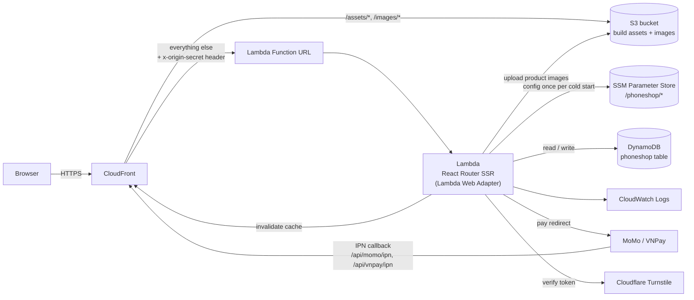
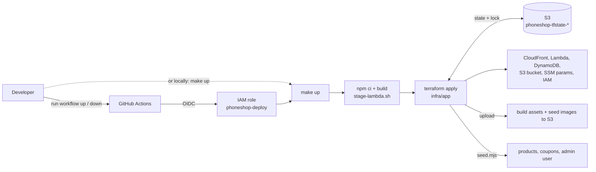
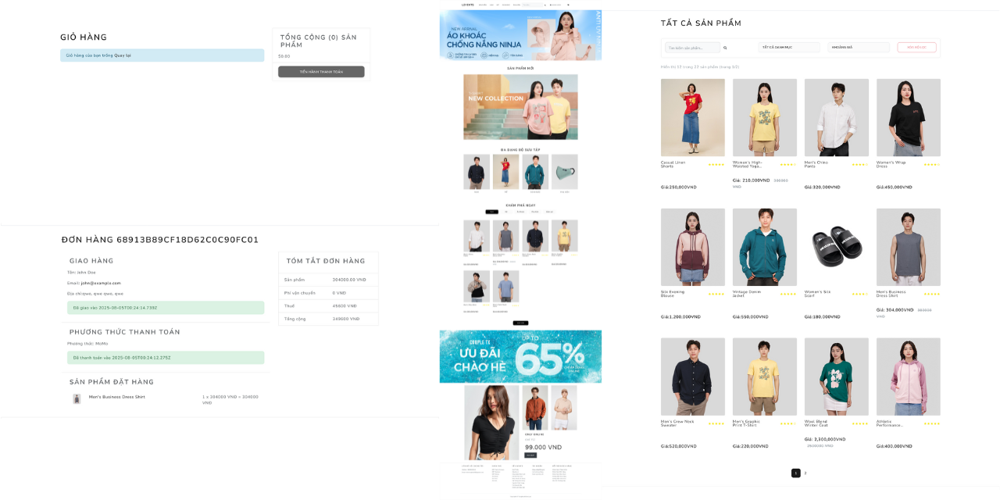
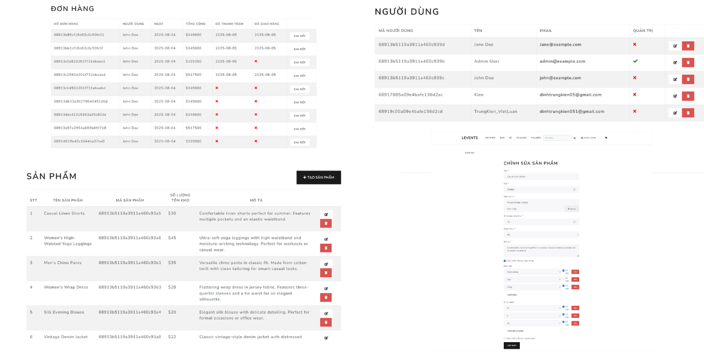

# Phoneshop

A phone store web app built with React Router 8 (SSR) and run serverless on AWS: CloudFront, Lambda, DynamoDB, S3 and SSM, all managed by Terraform.

## Features

**Customer**
- Browse, search, filter and compare phones
- Cart, coupons, checkout and order tracking
- Pay with COD, MoMo or VNPay
- Trade in old phones (`/thu-cu-doi-moi`) and check warranty by IMEI (`/bao-hanh`)
- Product reviews, flash sale countdown, installment preview
- Login and register, protected by Cloudflare Turnstile and rate limits

**Admin** (`/admin`)
- Products and variants (CRUD, image upload to S3)
- Orders and status updates
- Users, coupons and trade in leads

## Tech Stack

- **App:** React Router 8 (framework mode, SSR), React 19, Tailwind CSS 4, TypeScript, Vite
- **Data:** DynamoDB single table (PK/SK, GSI1 user orders, GSI2 all orders, TTL)
- **AWS:** CloudFront, Lambda (Node 22, arm64, Lambda Web Adapter), S3, SSM Parameter Store, CloudWatch Logs
- **IaC / CI:** Terraform (S3 state with lockfile), GitHub Actions with OIDC

## Architecture

### Request flow



- S3 is private. Only this CloudFront distribution can read it (OAC).
- Lambda rejects any request without the `x-origin-secret` header, so users must go through CloudFront.
- Hashed files in `/assets/*` are cached forever. Pages use a 0s default TTL and are invalidated when admin changes data.

### Deploy flow



`infra/bootstrap` is applied once by hand. It creates the state bucket, the GitHub OIDC deploy role and a budget alert.

## Getting Started

### Local dev

Needs Node 22 and AWS creds that can reach a DynamoDB table named `phoneshop*`.

```bash
cd web
cp .env.example .env   # fill TABLE, SESSION_SECRET, ADMIN_EMAIL, ADMIN_PASSWORD
npm install
npm run seed           # products, 2 coupons, 1 admin
npm run dev            # http://localhost:5173
```

### Deploy to AWS

1. Bootstrap once:
   ```bash
   cd infra/bootstrap && terraform init && terraform apply
   ```
2. Put `TF_VAR_*` values in `infra/app/.env` (or GitHub secrets for CI):
   `admin_email`, `admin_password`, and optional `momo_*`, `vnp_*`, `turnstile_secret`.
3. Create or delete the stack:
   ```bash
   make up     # build, stage Lambda, terraform apply, seed
   make url    # print the CloudFront URL
   make down   # destroy everything
   ```

In CI, run the `up` or `down` workflow from the Actions tab. It needs the `AWS_DEPLOY_ROLE_ARN` secret.

## Project Structure

```
├── web/                  # React Router 8 app
│   ├── app/
│   │   ├── routes/       # pages, admin, payment IPN endpoints
│   │   ├── lib/          # *.server.ts: db, auth, orders, payment, images, env
│   │   ├── components/   # UI components
│   │   └── data/         # trade in price table
│   ├── scripts/          # seed.mjs, stage-lambda.sh
│   └── seed-images/      # images uploaded to S3 by Terraform
├── infra/
│   ├── bootstrap/        # state bucket, OIDC deploy role, budget
│   └── app/              # CloudFront, Lambda, DynamoDB, S3, SSM
├── .github/workflows/    # up.yml, down.yml
├── Makefile              # make up / down / url
└── backend/, frontend/   # old MERN version, not deployed
```

## Images

User view:


Admin view:

